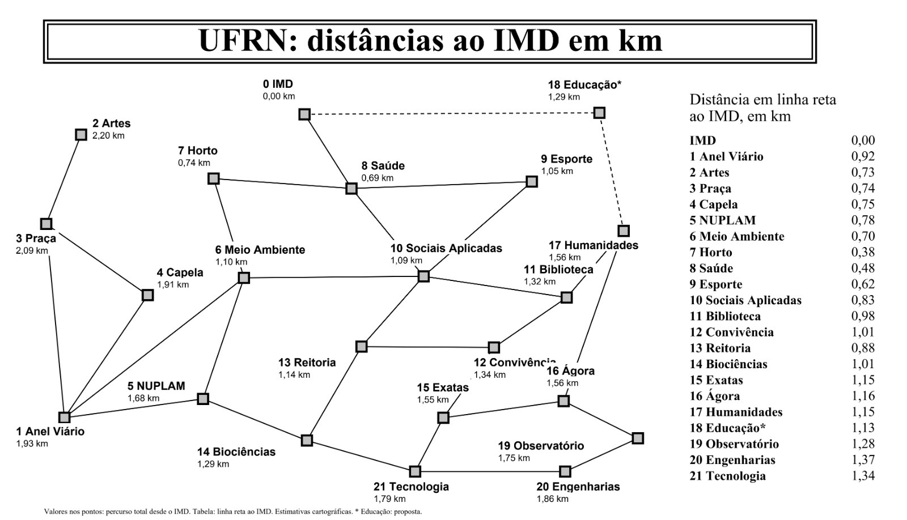

# Otimizador de Rotas do Campus UFRN (Estratégias BFS e DFS)

Projeto desenvolvido para a disciplina de **Estruturas de Dados Básicas II** da Universidade Federal do Rio Grande do Norte (UFRN).

## Componentes
- João Carlos
- Matheus
- Victor Ramon Firmo Moreira

---

## Objetivo do Projeto
O objetivo deste projeto é modelar um subconjunto importante do campus da UFRN utilizando **Teoria dos Grafos**, onde os prédios/pontos de interesse representam os **nós (vértices)** e as vias de ligação representam as **arestas**. 

A partir dessa estrutura, implementamos algoritmos clássicos de busca para resolver problemas práticos de navegação e auditoria no campus:
1. **BFS (Busca em Largura / Breadth-First Search):** Utilizada para encontrar o caminho com o **menor número de conexões (saltos)** entre dois pontos de interesse, além de calcular a "vizinhança de alcance" (locais alcançáveis em até $N$ passos).
2. **DFS (Busca em Profundidade / Depth-First Search):** Utilizada para **exploração exaustiva de rotas**, **detecção de ciclos** (ideal para auditorias em rotas de evacuação ou becos sem saída) e **mapeamento de componentes conexos** (identificação de áreas isoladas).

---

## Representação do Mapa (UFRN)
Baseado no mapeamento topológico em relação ao IMD (nó 0), contemplando os principais centros e pontos de convivência do campus:

 *(Substitua ou adicione a imagem do mapa na pasta docs)*

---

## ⚙️ Instruções de Execução

### Pré-requisitos
Certifique-se de ter o **Python 3.10+** instalado em sua máquina.

### Executando o projeto
Clone o repositório e execute o script principal via terminal:

```bash
python3 main.py
```
